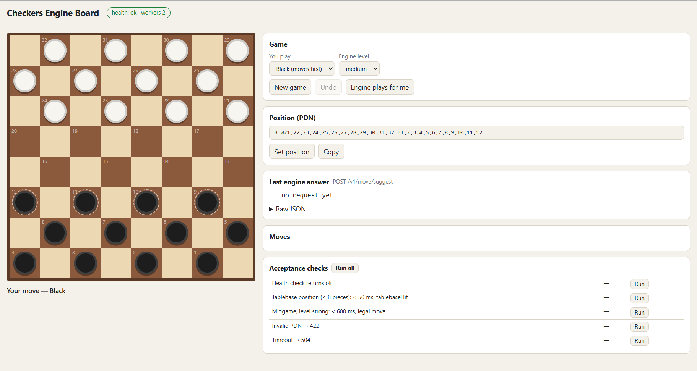

# Checkers REST Web API

Returns the best move for an English checkers position in PDN, using the KingsRow engine with the
2–8 piece endgame databases (Cake format, the same data as Chinook's).

## Run under IIS

1. **Engine.** Install CheckerBoard 64-bit, then KingsRow 64-bit into the same folder:
   - https://edgilbert.org/ItalianCheckers/downloads/CheckerBoardSetup64.1.78.exe
   - https://edgilbert.org/EnglishCheckers/downloads/KingsrowSetup64.1.20.exe
2. **Databases** (Cake format, 2–8 pieces). Put all of the following files into one folder.
   Do not use `<CheckerBoard>\db`: it already holds KingsRow-format files, and the two formats cannot
   be mixed.
   - **db2–db4:** all files from
     https://github.com/eygilbert/CheckerBoard/tree/master/db
   - **db5–db8:**
     - https://www.fierz.ch/db6.zip (contains db5 and db6)
     - https://www.fierz.ch/db7.zip
     - https://www.fierz.ch/db8_1.zip
     - https://www.fierz.ch/db8_2.zip
3. **Paths.** Configure `Checkers.Api/appsettings.json`:
   - `Engine:Path`: `"<CheckerBoard>\\engines\\Kingsrow64.dll"`
   - `Engine:Databases`: the path to the folder with db2–db8, e.g. `"D:\\tb\\cake"`
4. **Server.** Install:
   - IIS, including **IIS Management Scripts and Tools**;
   - the .NET 10 SDK and the ASP.NET Core 10 Hosting Bundle (https://dotnet.microsoft.com/download/dotnet/10.0).

   Then run `iisreset`.
5. **Publish and install** (PowerShell as Administrator, from the repository root):

   ```powershell
   Set-ExecutionPolicy -Scope Process Bypass -Force
   dotnet publish Checkers.Api -c Release -o <app_path>\checkers
   .\deploy\Install-IIS.ps1 -PublishPath <app_path>\checkers
   ```

   The site uses port 8080; to use another port, add `-Port <port>`.
6. **Check.** Open http://localhost:8080/ to see the simple checkers board interface.

## Assumptions

- **Cake databases instead of Chinook.** The Chinook database download links do not work
  (https://webdocs.cs.ualberta.ca/~chinook/databases/), so I use the Cake databases by Martin Fierz:
  the same Chinook data in another format.

## Checkers board interface


